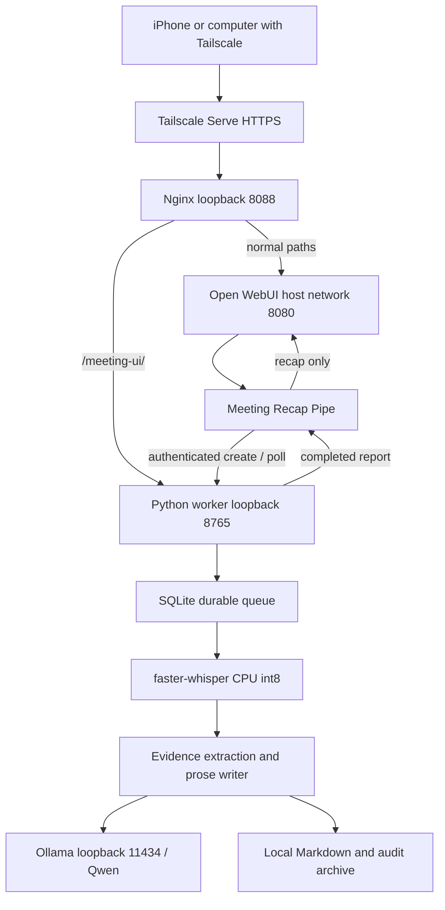

> Reference network: Linux host networking. Tailscale in the diagram is an optional PoC HTTPS entry point. See [generic installation](INSTALL.md).

# Architecture and component roles

## Request lifecycle

1. The user selects **SMARTINI’s** in a saved Open WebUI chat.
2. The Python Pipe creates a session using the worker API key and authenticated Open WebUI user ID. The chat/message IDs form the idempotency key.
3. The Pipe emits an embedded upload card from the public HTTPS origin. The phone uploads an existing recording using the card, not the normal attachment/microphone path.
4. Nginx routes `/meeting-ui/` to the loopback worker. All other paths go to Open WebUI. The HTTPS entry point is supplied by the deployment; Tailscale is one optional tested choice.
5. The worker archives audio atomically and queues a SQLite job. A single processing thread loads faster-whisper, transcribes using the job’s selected language and mixed-language setting.
6. It saves timestamped segments, releases Whisper, and invokes the local report generator.
7. The reporter submits bounded requests to Ollama. Qwen selects source references; Python resolves original quotes and timestamps. A separate writing pass creates connected prose.
8. The worker publishes report/transcript files and marks the job completed. The Pipe returns the recap while omitting the evidence appendix and full transcript from chat. The complete archive remains on disk.

## What the parts do

| Part | Role | What it does not do |
|---|---|---|
| Local host | Runs services and stores local data | Its disk is not automatically backed up |
| Tailscale | Private remote connectivity and HTTPS | It is not an audio or summarization engine |
| Open WebUI | Account, chat and result display | It does not run this pipeline's Whisper itself |
| Pipe function | Bridges chat to the durable worker | It does not own the durable processing job |
| Upload card | File upload and stage progress | It does not record audio in the browser |
| Python worker | Queue, orchestration, files and status | It does not schedule unrelated Ollama tasks |
| faster-whisper | Speech recognition with configurable language detection | It does not establish speaker identities |
| Ollama | Local model API and inference runtime | It is not the report policy/validator |
| Qwen | Evidence extraction and natural-language writing | Its output is not automatically factual |
| Reporter | Evidence references, chunking, validation, prose, Markdown | It exports knowledge without model calls; Open WebUI owns the optional search index |

## Context and quality

15–90-minute transcript support uses conservative bounded chunks, not a single request containing all text. The default context is 4096 tokens. Evidence requests select integer source references; quoted text and timestamp IDs come from Python. Confirmed decisions are separated from other findings in writing batches. The writer gets one corrective retry before failing visibly. These controls validate structure and provenance; they cannot prove semantic entailment or correct ASR mistakes.

Readable reports preserve checked source evidence in an expandable archive appendix. The chat projection removes that appendix and its note links. It also does not append `transcript.md`. Editing the Pipe affects chat presentation; editing the reporter affects future generated reports. These are separate deployment steps.

## State and failure behavior

`waiting_upload → uploading → queued → transcribing → analyzing → completed / failed`.

Upload sessions last 30 minutes before submission; card capabilities expire after 24 hours. Maximum upload size is 512 MiB. Job IDs are not passwords: API reads additionally require the API key and matching owner. A scoped upload token permits access to that card/status/upload, not arbitrary report retrieval.

SQLite retains state across SSH/browser disconnection. A server/service restart requeues jobs interrupted in transcription/analysis and starts them from archived audio. It does not resume the exact audio segment or analysis chunk automatically. A failed writing job can be recovered manually using cached checked extraction. Failed jobs are not automatically retried. The recovery helper is a manual tool: do not run two recoveries of the same job concurrently.

## Trust boundaries

Worker API and model API are loopback services. Nginx exposes only the browser card route, not the worker's `/v1/` API. Host-network Open WebUI can call loopback directly. The worker key belongs only in private server settings and admin Function Valves, never in the HTML card. Card URLs contain scoped bearer capabilities and should not be shared or logged. Transcript text is untrusted model input, not executable instructions.

The current worker API returns report and transcript to the Pipe on completion; the Pipe suppresses the transcript from its returned chat text. This is a presentation choice, not a change to backend archival storage or its authenticated payload.

## Knowledge and run monitoring extension

`findings.json` → deterministic `meeting_knowledge.py` → `knowledge.md`
→ `ingestion/ingest_meetings.py` → Open WebUI file processing/embeddings
→ chosen Knowledge collection → retrieved excerpts → the selected chat model.

The optional user-service wrapper records each ingestion result in its own SQLite
history, then attempts a weekday Telegram summary. Its dashboard is read-only,
password protected and bound to loopback; Tailscale Serve exposes a separate
private HTTPS listener. It does not change the audio worker or chat proxy.
See [knowledge](KNOWLEDGE-BASE.md) and [monitoring](../monitoring/README.md).
